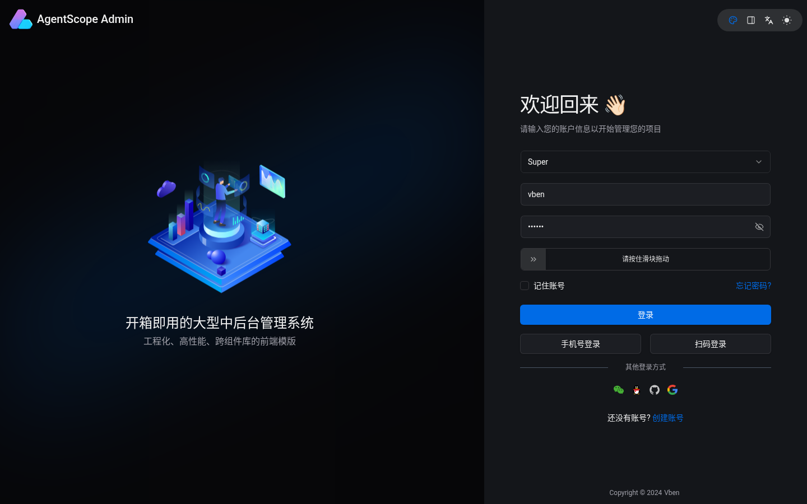
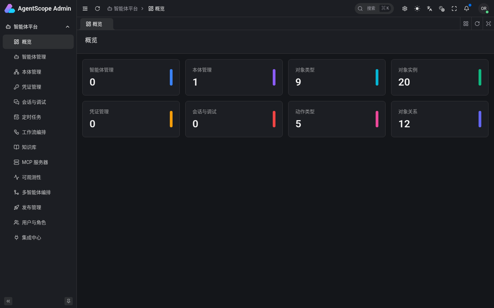
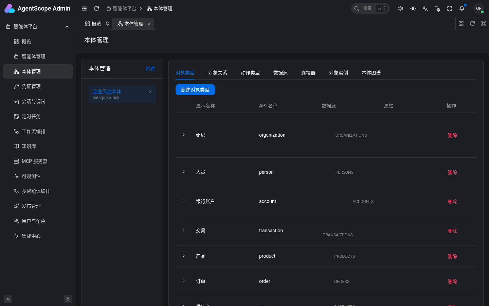
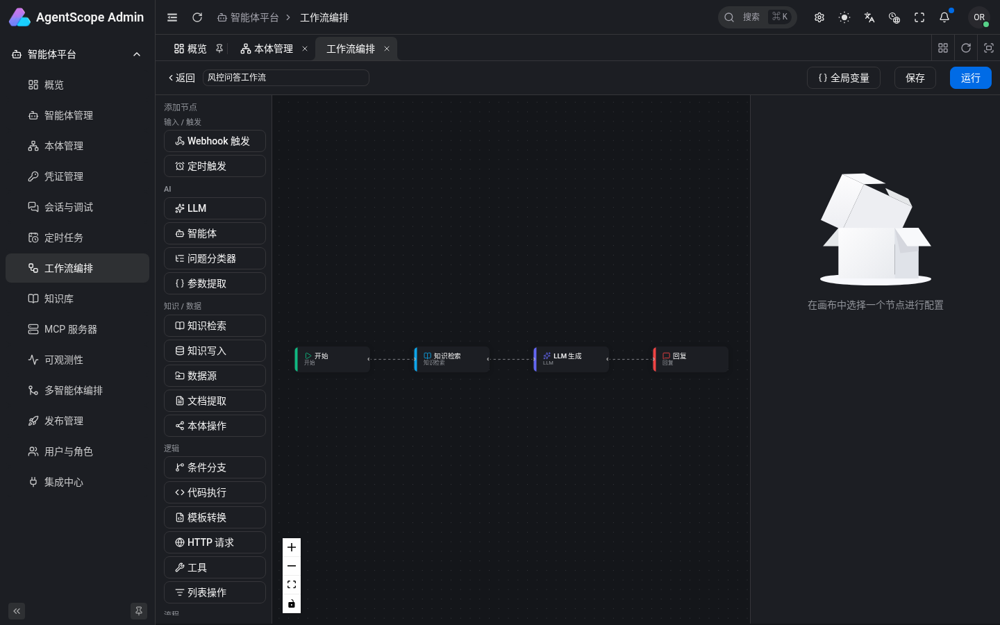
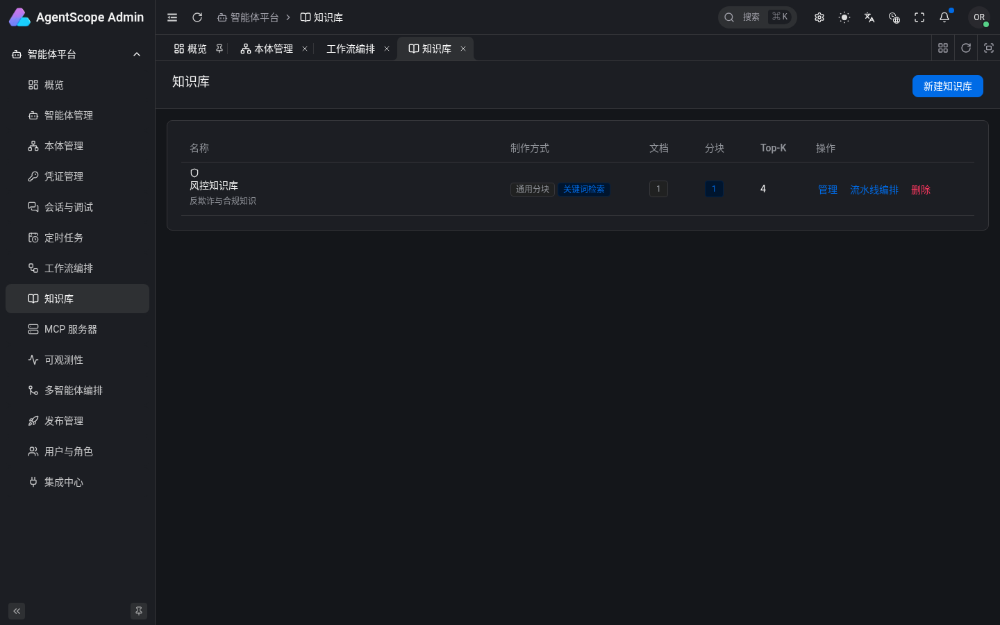

# AgentScope Admin

**English** | [简体中文](README.zh-CN.md)

A B2B admin console for managing the full lifecycle of AI agents, built on [AgentScope](https://github.com/agentscope-ai/agentscope). Its core idea is a built-in **Palantir-style ontology / semantic layer**: once an agent is bound to the ontology, it can run precise semantic queries and actions, including connectors that write back to external systems.

- **Front end**: [Vue Vben Admin](https://github.com/vbenjs/vue-vben-admin) 5 (Element Plus edition, `apps/web-ele`), Vue 3 + TypeScript + Vite, pnpm / Turborepo monorepo.
- **Back end**: a real FastAPI service (`server/`) built directly on AgentScope's app layer (`agentscope.create_app()`), extended with an ontology, knowledge bases, workflows, publishing, dashboard, per-agent model profiles and vben-compatible auth.

The UI is in Chinese. A static project wiki (Chinese) lives in [`wiki/`](wiki/README.md); open `wiki/index.html` in a browser.

## Features

| Area | What it does |
| --- | --- |
| Agent lifecycle | Create / edit / delete agents with forms rendered from the backend JSON Schema |
| Ontology / semantic layer | Object types, properties, link types, action types, instances, data sources and connector mappings |
| Model profiles | Per-agent default credential / model, generation parameters, fallback model, permission mode |
| Credentials & models | LLM provider credentials (OpenAI, DashScope, DeepSeek, Anthropic …) |
| Playground | SSE streaming chat with tool calls, reasoning and human-in-the-loop tool confirmation |
| Multi-agent orchestration | Sequential, parallel, aggregate, router, supervisor–worker and handoff patterns |
| Workflow | Dify-style DAG canvas (including ontology nodes) with topological SSE execution |
| Knowledge base | Chunking strategies × index types, visual ingestion pipeline, retrieval test (TF-IDF) |
| Publish | Freeze an agent as a public app (Web App / REST / embed) with API keys; Dify-style `POST /v1/apps/{token}/chat-messages` |
| MCP servers | stdio / http MCP registry, per-tool toggles, connectivity test |
| Observability | Token usage / cost and trace drill-down by agent → session → run |
| Multi-tenant / RBAC | Users with admin / editor / viewer roles and owner-based isolation |
| Schedules | Cron schedules (AgentScope `/schedule`) |
| Dashboard | Aggregate stats across agents, credentials, sessions and the ontology |
| CLI | `agentscope-admin` for agents, knowledge, workflows, publishing and keys |

`docs/CONFIG-ALIGNMENT.md` maps every agent setting between the Claude Agent SDK, AgentScope 2.0 and this UI.

## Screenshots

Captured locally with headless Chromium: the real backend (`uvicorn app.main:app`, Redis) plus `pnpm dev:ele`, after running `server/seed.sh` (enterprise-risk demo ontology, a demo knowledge base and a RAG workflow). No LLM credential was configured, so nothing that needs a model was run.

| Login | Dashboard |
| --- | --- |
|  |  |
| **Ontology (seeded enterprise-risk model)** | **Workflow editor (seeded RAG workflow)** |
|  |  |
| **Knowledge base** |  |
|  |  |

## Tech stack

- **Front end**: Vue 3, TypeScript, Element Plus, Vue Flow (canvas), CodeMirror, Vite, pnpm workspaces + Turborepo (Vben Admin 5)
- **Back end**: Python 3.12, FastAPI, SQLModel (SQLite), AgentScope 2.x app layer, Redis, APScheduler, sse-starlette, httpx
- **LLM**: DeepSeek by default (OpenAI-compatible), also DashScope / OpenAI / Anthropic via AgentScope credentials

## Quick start

Prerequisites: Node.js `^22.18.0 || ^24` (`.node-version` is 22.22.0), pnpm ≥ 11 (`packageManager: pnpm@11.2.2`), Python 3.12, Redis on `localhost:6379`.

```bash
git clone https://github.com/gatesenman/agentscope-admin.git
cd agentscope-admin

./start-dev.sh           # backend :8000 + frontend :5777, Ctrl-C stops both
./start-dev.sh --seed    # seed demo data first (ontology + knowledge base + RAG workflow)
```

Manual:

```bash
# back end
cd server
./start.sh               # venv + deps + Redis check + uvicorn --reload
./seed.sh                # optional demo data
# → http://localhost:8000  (/health, /docs)

# front end (repo root)
pnpm install
pnpm dev:ele             # → http://localhost:5777 (proxies /api to :8000)
```

The login page accepts any account (the backend's compat auth returns a static admin token); complete the slider check and click 登录.

Build and checks:

```bash
pnpm build:ele
pnpm check:type          # turbo typecheck
pnpm lint
pnpm test:unit
cd server && pytest      # backend unit tests
```

CLI (from a checkout: `./server/agentscope-admin …`, or `cd server && pip install -e .`):

```bash
agentscope-admin serve --reload
agentscope-admin seed
agentscope-admin agents list
agentscope-admin knowledge retrieve <kb_id> "可疑交易上报阈值"
agentscope-admin workflow run <workflow_id> --input query="电汇要上报吗"
agentscope-admin publish list
agentscope-admin keys create <app_id> --name ci-key
```

## Project structure

```
apps/web-ele/                 # Element Plus admin app
  src/views/agentscope/       # dashboard, agents, ontology, credentials, sessions, schedules,
                              # workflow (+ editor), knowledge (+ pipeline), mcp, observability,
                              # orchestration, publish, webapp, users, integration
  src/router/routes/modules/agentscope.ts
packages/  internal/          # Vben Admin shared packages and tooling
server/                       # FastAPI backend (see server/README.md)
  app/main.py                 # create_app() + routers
  app/{ontology,knowledge,workflow,publish,agent_profile,dashboard,preferences,compat_auth}
  scripts/                    # seed scripts
  start.sh  seed.sh  agentscope-admin  tests/
wiki/                         # static project wiki (HTML + markdown sources, build_wiki.py)
docs/CONFIG-ALIGNMENT.md      # agent config alignment table
docs-internal/COMPONENTS.md
start-dev.sh                  # one-command local dev
```

## Configuration

Back end (env prefix `AGENTSCOPE_ADMIN_`, see `server/app/settings.py`):

| Variable | Default | Purpose |
| --- | --- | --- |
| `AGENTSCOPE_ADMIN_REDIS_HOST` / `_REDIS_PORT` / `_REDIS_PASSWORD` | `localhost` / `6379` / — | Redis used by AgentScope storage |
| `AGENTSCOPE_ADMIN_WORKSPACE_DIR` | `server/data/workspaces` | per-session workspaces |
| `HOST` / `PORT` / `RELOAD` | `0.0.0.0` / `8000` / `1` | uvicorn options used by `start.sh` |

Data: AgentScope state in Redis; ontology, agent profiles, knowledge, workflows, published apps and preferences in SQLite (`server/data/`).

Front end: `apps/web-ele/.env.development` (`VITE_PORT=5777`, `VITE_GLOB_API_URL=/api`, `VITE_NITRO_MOCK=false`).

## Known issues

- `server/requirements.txt` installs AgentScope from the `main` branch without a pin. Current `main` no longer exports `LocalWorkspaceManager` from `agentscope.app._manager`, so the backend fails to start with an `ImportError`. While writing this README the backend was run with AgentScope pinned to commit `68f643db4d814d7a639b920c8a82ecb6b27bd39c` (2026-06-05):
  ```bash
  pip install --force-reinstall --no-deps "agentscope @ git+https://github.com/agentscope-ai/agentscope.git@68f643db4d814d7a639b920c8a82ecb6b27bd39c"
  ```

## Contributing

Issues and pull requests are welcome. Commits follow Conventional Commits (commitlint + lefthook are configured). Please run `pnpm check:type`, `pnpm lint` and the backend tests before opening a PR. `wiki/build_wiki.py` regenerates the wiki HTML from `wiki/content/*.md`.

## Acknowledgements & license

The front end is based on [Vue Vben Admin](https://github.com/vbenjs/vue-vben-admin) (MIT). `README.ja-JP.md` and `DEVELOPER.md` are inherited from the upstream template. The repository's [LICENSE](LICENSE) is the upstream MIT license (Copyright © 2024-present, Vben).
