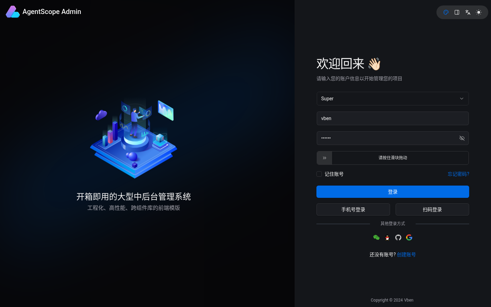
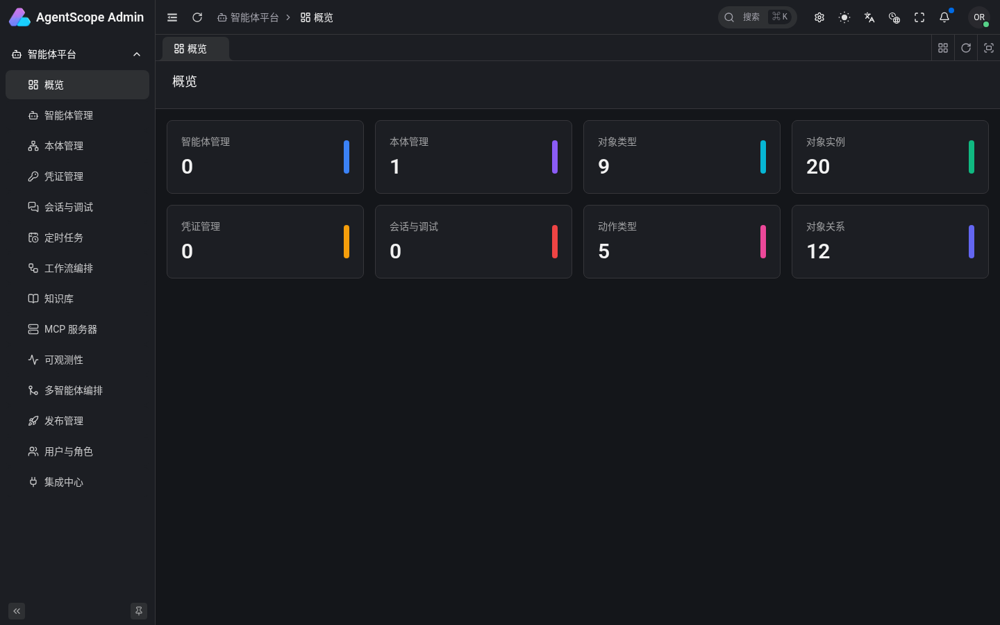
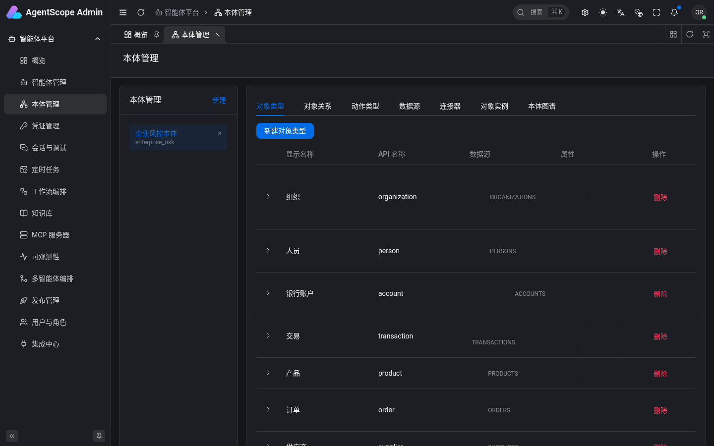
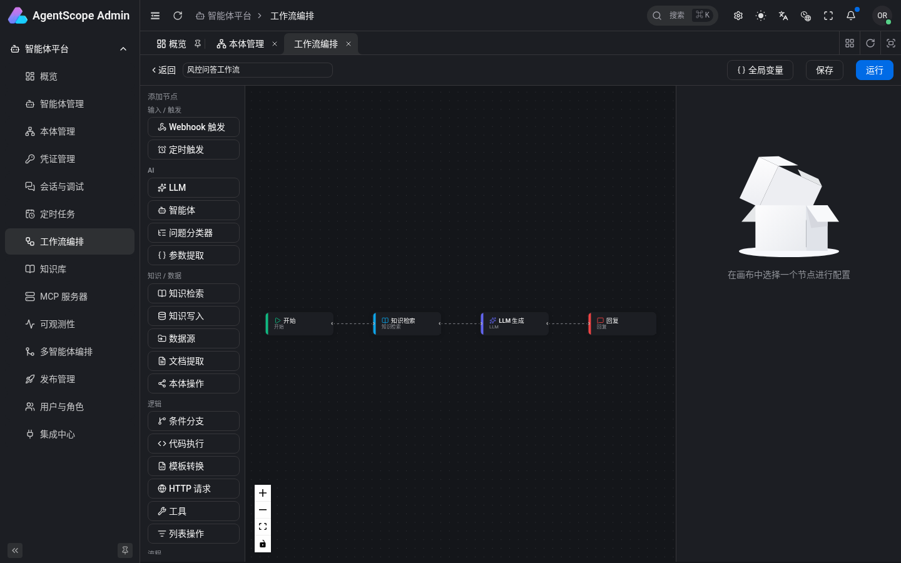
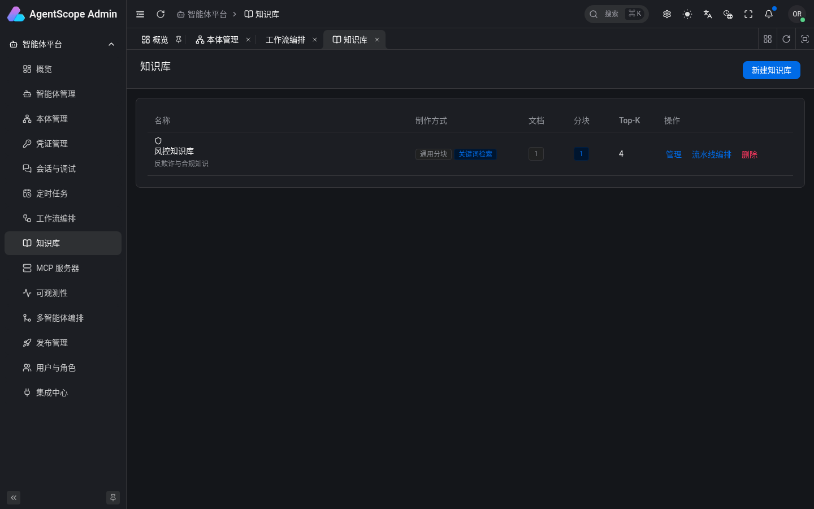

# AgentScope Admin

[English](README.md) | **简体中文**

**AgentScope Admin** 是一个面向 B 端的智能体（Agent）全生命周期管理后台，基于 [AgentScope](https://github.com/agentscope-ai/agentscope) 构建。核心特色是内置一套 **Palantir 风格的本体 / 语义层（Ontology）**：智能体绑定本体后，即可进行精确的语义查询与动作执行（含连接器写回外部系统）。

- **前端**：基于 [Vue Vben Admin](https://github.com/vbenjs/vue-vben-admin) 5（Element Plus 版，`apps/web-ele`），Vue 3 + TypeScript + Vite，pnpm / Turborepo monorepo。
- **后端**：真实的 FastAPI 服务（`server/`），直接构建在 AgentScope 应用层（`agentscope.create_app()`）之上，扩展了本体、知识库、工作流、发布、看板、智能体模型配置以及兼容 vben 的登录接口。

项目 Wiki 是一套静态站点，位于 [`wiki/`](wiki/README.md)，用浏览器打开 `wiki/index.html` 即可离线阅读。

## 功能

| 模块 | 说明 |
| --- | --- |
| 智能体生命周期 | 基于后端 JSON Schema 动态渲染表单，创建 / 编辑 / 删除智能体 |
| 本体 / 语义层 | 对象类型、属性、连接类型、动作类型、实例，以及数据源与连接器映射 |
| 模型配置 | 每个智能体的默认凭证 / 模型、生成参数、兜底模型、权限模式 |
| 凭证与模型 | LLM 厂商凭证（OpenAI、DashScope、DeepSeek、Anthropic……） |
| 调试台 Playground | SSE 流式对话 + 工具调用 / 思考链 + 人在环工具确认 |
| 多智能体编排 | 顺序、并行、聚合、路由、主管-工人、交接 6 种模式 |
| 工作流编排 | Dify 风格 DAG 画布（含本体操作节点）+ 拓扑 SSE 执行 |
| 知识库 | 分块策略 × 索引方式、可视化入库流水线、召回测试（TF-IDF） |
| 发布 | 把智能体冻结为公开应用（Web App / REST / 嵌入）+ API Key；Dify 风格 `POST /v1/apps/{token}/chat-messages` |
| MCP 服务器 | stdio / http MCP 注册表、工具开关、连通测试 |
| 可观测性 | Token 用量 / 成本，按智能体 → 会话 → 执行链路下钻 trace |
| 多租户 / RBAC | 用户 + admin / editor / viewer 角色，按 owner 隔离 |
| 定时任务 | cron 调度（基于 AgentScope `/schedule`） |
| 看板 | 跨智能体、凭证、会话、本体的聚合统计 |
| 命令行 | `agentscope-admin`：智能体、知识库、工作流、发布、密钥 |

`docs/CONFIG-ALIGNMENT.md` 逐项对照了 Claude Agent SDK、AgentScope 2.0 与本平台 UI 的智能体配置项。

## 截图

以下截图在本地用无头 Chromium 实拍：真实后端（`uvicorn app.main:app` + Redis）+ `pnpm dev:ele`，并先运行了 `server/seed.sh`（企业风险演示本体、演示知识库和 RAG 工作流）。未配置任何 LLM 凭证，因此没有运行需要模型的功能。

| 登录 | 概览看板 |
| --- | --- |
|  |  |
| **本体管理（演示：企业风险本体）** | **工作流编辑器（演示：RAG 工作流）** |
|  |  |
| **知识库** |  |
|  |  |

## 技术栈

- **前端**：Vue 3、TypeScript、Element Plus、Vue Flow（画布）、CodeMirror、Vite、pnpm workspace + Turborepo（Vben Admin 5）
- **后端**：Python 3.12、FastAPI、SQLModel（SQLite）、AgentScope 2.x 应用层、Redis、APScheduler、sse-starlette、httpx
- **LLM**：默认 DeepSeek（兼容 OpenAI 接口），也可通过 AgentScope 凭证接入 DashScope / OpenAI / Anthropic 等

## 快速开始

前置依赖：Node.js `^22.18.0 || ^24`（`.node-version` 为 22.22.0）、pnpm ≥ 11（`packageManager: pnpm@11.2.2`）、Python 3.12、本地 Redis（`localhost:6379`）。

```bash
git clone https://github.com/gatesenman/agentscope-admin.git
cd agentscope-admin

./start-dev.sh           # 后端 :8000 + 前端 :5777，Ctrl-C 同时停止
./start-dev.sh --seed    # 先灌入演示数据（本体 + 知识库 + RAG 工作流）再启动
```

手动启动：

```bash
# 后端
cd server
./start.sh               # venv + 依赖 + 检查 Redis + uvicorn --reload
./seed.sh                # 可选：演示数据
# → http://localhost:8000（/health、/docs）

# 前端（仓库根目录）
pnpm install
pnpm dev:ele             # → http://localhost:5777（/api 代理到 :8000）
```

登录页任意账号均可（后端兼容登录接口返回固定的管理员 token），拖动滑块验证后点击「登录」。

构建与检查：

```bash
pnpm build:ele
pnpm check:type          # turbo typecheck
pnpm lint
pnpm test:unit
cd server && pytest      # 后端单元测试
```

命令行（源码目录下 `./server/agentscope-admin …`，或 `cd server && pip install -e .`）：

```bash
agentscope-admin serve --reload
agentscope-admin seed
agentscope-admin agents list
agentscope-admin knowledge retrieve <kb_id> "可疑交易上报阈值"
agentscope-admin workflow run <workflow_id> --input query="电汇要上报吗"
agentscope-admin publish list
agentscope-admin keys create <app_id> --name ci-key
```

## 项目结构

```
apps/web-ele/                 # Element Plus 管理后台
  src/views/agentscope/       # 看板、智能体、本体、凭证、会话、定时任务、工作流（含编辑器）、
                              # 知识库（含流水线）、MCP、可观测性、多智能体编排、发布、Web App、用户、集成
  src/router/routes/modules/agentscope.ts
packages/  internal/          # Vben Admin 公共包与工程工具
server/                       # FastAPI 后端（详见 server/README.md）
  app/main.py                 # create_app() + 路由装配
  app/{ontology,knowledge,workflow,publish,agent_profile,dashboard,preferences,compat_auth}
  scripts/                    # 演示数据脚本
  start.sh  seed.sh  agentscope-admin  tests/
wiki/                         # 静态项目 Wiki（HTML + markdown 源 + build_wiki.py）
docs/CONFIG-ALIGNMENT.md      # 智能体配置对齐表
docs-internal/COMPONENTS.md
start-dev.sh                  # 一键本地开发
```

## 配置

后端（环境变量前缀 `AGENTSCOPE_ADMIN_`，见 `server/app/settings.py`）：

| 变量 | 默认值 | 用途 |
| --- | --- | --- |
| `AGENTSCOPE_ADMIN_REDIS_HOST` / `_REDIS_PORT` / `_REDIS_PASSWORD` | `localhost` / `6379` / — | AgentScope 存储使用的 Redis |
| `AGENTSCOPE_ADMIN_WORKSPACE_DIR` | `server/data/workspaces` | 会话工作区目录 |
| `HOST` / `PORT` / `RELOAD` | `0.0.0.0` / `8000` / `1` | `start.sh` 使用的 uvicorn 参数 |

数据：AgentScope 自身状态存 Redis；本体、智能体配置、知识库、工作流、发布应用、偏好设置存 SQLite（`server/data/`）。

前端：`apps/web-ele/.env.development`（`VITE_PORT=5777`、`VITE_GLOB_API_URL=/api`、`VITE_NITRO_MOCK=false`）。

## 已知问题

- `server/requirements.txt` 直接安装 AgentScope 的 `main` 分支且未固定版本。目前 `main` 已不再从 `agentscope.app._manager` 导出 `LocalWorkspaceManager`，后端启动时会报 `ImportError`。编写本文档时，后端是把 AgentScope 固定到提交 `68f643db4d814d7a639b920c8a82ecb6b27bd39c`（2026-06-05）后运行成功的：
  ```bash
  pip install --force-reinstall --no-deps "agentscope @ git+https://github.com/agentscope-ai/agentscope.git@68f643db4d814d7a639b920c8a82ecb6b27bd39c"
  ```

## 参与贡献

欢迎提 Issue 或 Pull Request。提交信息遵循 Conventional Commits（已配置 commitlint + lefthook）。提交 PR 前请运行 `pnpm check:type`、`pnpm lint` 和后端测试。修改 `wiki/content/*.md` 后可用 `wiki/build_wiki.py` 重新生成 Wiki 页面。

## 致谢与许可证

前端基于 [Vue Vben Admin](https://github.com/vbenjs/vue-vben-admin)（MIT）。`README.ja-JP.md` 和 `DEVELOPER.md` 沿用自上游模板。仓库的 [LICENSE](LICENSE) 为上游 MIT 许可证（Copyright © 2024-present, Vben）。

> 本文件替换了此前从 Vben Admin 模板沿用的中文 README（其内容介绍的是模板本身而非本项目）。
